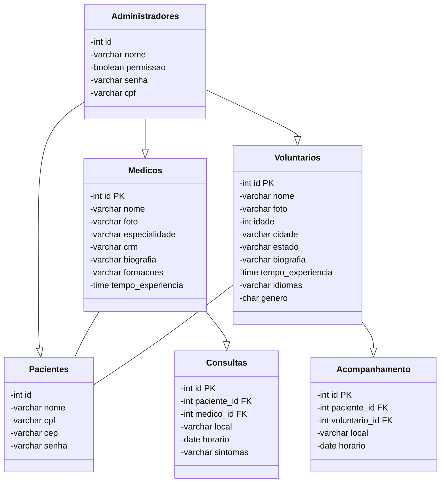
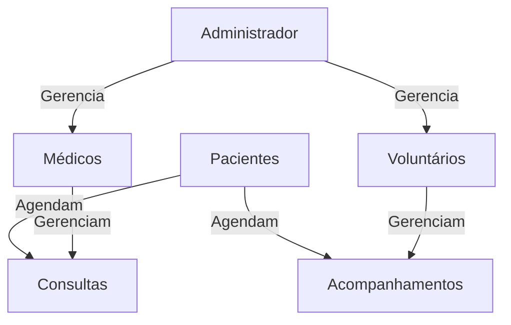

# Vitale - Documentação e Levantamento de Requisitos
**Autores:** Maria Eduarda Correa, Rian , Thayssa Maneo  
**Padrão Internacional:** ISO/IEC/IEEE 29148:2018
**Versão:** 1.0.0  
**Data:** 05/11/2026
---
## 0. Pesquisas - Principais problemas relacionados ao acesso de idosos a conteúdos de saúde
### 0.1  Interfaces Inacessíveis e Falta de Design Inclusivo (UI/UX):
**Ausência de recursos essenciais de acessibilidade:** Diversos portais e aplicativos falham em oferecer suporte a ferramentas básicas, como audiodescrição, ajustes de contraste e leitor de tela para pessoas com deficiências visuais ou auditivas.
**Design inadequado às mudanças cognitivas e sensoriais:** As plataformas raramente são projetadas levando em consideração as necessidades da população idosa, apresentando elementos visuais confusos, ícones de difícil visualização, botões pequenos e excesso de termos técnicos de tecnologia ("tecniquês") que prejudicam a navegação intuitiva.
### 0.2   Barreiras de Linguagem e Complexidade do Conteúdo:
**Linguagem médica técnica sem simplificação:** Muitas plataformas institucionais de saúde utilizam terminologias científicas e médicas densas (como descrições técnicas de vacinas e mecanismos de ação) sem a devida adaptação para pessoas com menor escolaridade ou baixo letramento em saúde.
**Falta de resumos executivos:** Há escassez de materiais informativos formatados em linguagem simples e direta, o que limita a compreensão e a capacidade do idoso de agir de forma autônoma sobre a própria saúde.
### 0.3   Insegurança, Medo de Errar e Ansiedade Gerontecnológica:
**Receio de falhas e golpes digitais:** É recorrente a hesitação dos idosos em interagir com interfaces digitais por medo de danificar o dispositivo, cometer erros de navegação ou ser vítima de fraudes e vazamento de dados pessoais.
**Baixa percepção de autoeficácia:** O preconceito etário (idadismo) e a falta de suporte inicial geram uma ansiedade gerontecnológica, fazendo com que muitos idosos se sintam incapazes de aprender a manusear novos recursos e acabem abandonando as aplicações.
### 0.4    Dificuldade na Avaliação Crítica da Informação (Letramento Digital):
**Vulnerabilidade à desinformação:** Devido ao baixo letramento digital em saúde, muitos idosos enfrentam grandes dificuldades para filtrar informações on-line, distinguir fontes de alta qualidade de conteúdos duvidosos e identificar fake news ou golpes.
**Falta de confiança na tomada de decisões:** Mesmo quando conseguem localizar informações digitais de saúde, o nível de confiança e segurança para avaliar a precisão do conteúdo e aplicar esses dados no cuidado diário permanece significativamente baixo.
### 0.5  Foco Excessivo no Modelo Biomédico e Escassez de Guias Práticos:
**Conteúdo centrado em doenças e tratamentos:** Os portais costumam focar excessivamente em um modelo curativo e biomédico (como campanhas de vacinação e gestão de morbidades crônicas), em vez de promover uma visão integral de envelhecimento ativo.
**Lacunas em áreas críticas de cuidado:** Há pouca oferta de orientações práticas direcionadas ao suporte de familiares e cuidadores, além da sub-representação de temas como saúde mental e cuidados paliativos.
### 0.6  Homogeneização do Usuário e Exclusão Social:
**Desconsideração das diversidades regionais e de comorbidades:** A maioria das soluções digitais adota uma abordagem genérica baseada em recomendações universais, ignorando adaptações para idosos com diferentes graus de limitação funcional, comorbidades ou pertencentes a comunidades rurais e indígenas.
**Dependência exclusiva do meio digital:** Ao focar a prestação de serviços e orientações quase exclusivamente em plataformas on-line ou aplicativos, acaba-se aprofundando a exclusão de idosos de menor renda e escolaridade que não possuem conectividade ou dispositivos adequados.
---
## 1. Introdução
### 1.1 Objetivo
Criar uma plataforma web e um aplicativo mobile para auxiliar o público idoso a sinalizar sintomas de forma acessível e intuitiva.
### 1.2 Funções do Sistema
De acordo com as necessidades dos stakeholders, as funções essenciais do sistema compreendem:

1. **Sinalização de sintomas:**
- O software deve permitir a sinalização de sintomas de forma simples.
- O software deve indicar especialistas que podem ser procurados com base nos sintomas.

2. **Contato com número de emergência:**
- Em caso de sintomas graves em áreas vitais, o sistema deve iniciar uma ligação para o contato de emergência.

3. **Recomendações para amenização de sintomas:**
- Após a sinalização dos sintomas, o sistema deve realizar recomendações para amenização dos sintomas, como exercícios de respiração, entre outros.

### 1.3 Páginas do Aplicativo
1. **Página de cadastro/login:** Permite o cadastro de usuários com verificações de segurança.
2. **Página de sinalização de sintomas:** Permite a sinalização de sintomas.
3. **Página de recomendações:** Realiza ligações para o contato de emergência e recomendações de técnicas de auxílio inicial ao paciente.

### 1.4 Tecnologias e Bibliotecas Utilizadas
O sistema será desenvolvido em duas aplicações independentes, sendo uma *mobile* e outra *web*. Ambas compartilharão a mesma API REST e estrutura de banco de dados, permitindo a integração e sincronização das informações entre as plataformas.
- **Frontend — Aplicativo Mobile:**
  - **Flutter:** Framework utilizado para o desenvolvimento do aplicativo mobile, possibilitando sua execução em dispositivos Android e iOS.
  - **Dart:** Linguagem de programação utilizada no desenvolvimento do aplicativo.
  - **Flutter Local Notifications:** Biblioteca utilizada para programar notificações locais, como lembretes de medicamentos.
- **Frontend — Plataforma Web:**
  - **React:** Biblioteca JavaScript utilizada para construção das interfaces e componentes da aplicação web.
  - **Next.js:** Framework baseado em React utilizado para estruturar a aplicação web, gerenciar rotas e otimizar o carregamento das páginas.
  - **TypeScript:** Superset de JavaScript utilizado para adicionar tipagem estática e aumentar a segurança e organização do código.
- **Backend** — Servidor e Regras de Negócio:
  - **Node.js:** Ambiente de execução utilizado para desenvolver o servidor.
  - **Express.js:** Framework utilizado para estruturar a API REST e gerenciar as requisições realizadas pelas aplicações.
  - **TypeScript:** Linguagem utilizada no desenvolvimento do backend, proporcionando maior segurança na implementação das funcionalidades.
- **Banco de Dados:**
  - **PostgreSQL:** Sistema gerenciador de banco de dados relacional utilizado para armazenar informações de usuários, medicamentos, sintomas, médicos, voluntários e agendamentos.
  - **Prisma ORM:** Ferramenta utilizada para facilitar a comunicação entre o backend e o banco de dados.
- **Bibliotecas e Integrações Complementares:**
  - **Firebase Cloud Messaging (FCM):** Serviço utilizado para o envio de notificações push.
  - **Google Maps API:** Serviço de mapas e geolocalização utilizado para auxiliar na localização de profissionais de saúde.
- **Segurança:**
  - **HTTPS/TLS:** Protocolo utilizado para proteger a comunicação entre as aplicações e o servidor.
  - **JWT (JSON Web Token):** Tecnologia utilizada para autenticação e gerenciamento de sessões.
  - **bcrypt:** Biblioteca utilizada para realizar o hash das senhas antes de seu armazenamento.
- **Ferramentas de Desenvolvimento:**
  - **Git e GitHub:** Controle de versão e colaboração entre os integrantes.
  - **Visual Studio Code:** Editor de código utilizado no desenvolvimento.
  - **Stitch:** Ferramenta utilizada para prototipação das interfaces.
---
## 2. Requisitos do Sistema
### 2.1 Requisitos Funcionais (RF)
| ID | Requisito | Descrição |
| - | - | - |
| **RF-01** | Gestão e Autenticação de Usuários | O sistema deve permitir o cadastro e login de usuários. Deve validar dados essenciais no cadastro. |
| **RF-02** | Sinalização e Triagem de Sintomas | O sistema deve permitir ao usuário selecionar sintomas de forma intuitiva e sugerir automaticamente especialidades médicas indicadas com base no relato. |
| **RF-03** | Recomendações de técnicas | O sistema deve realizar reomendações de técnicas para amenização de sintomas de acordo com a gravidade do sintoma. |
| **RF-04** | Ligação para contato de emergência | Em caso de sintomas graves o sistema deve realizar uma ligação para o contato de emergência. |

### 2.2 Requisitos Não Funcionais (RNF)

| ID | Categoria | Descrição |
| -| - | - |
| **RNF-01** | Usabilidade e Usabilidade Senior (UX/UI) | A interface web/mobile deve seguir diretrizes de acessibilidade (WCAG 2.1 AA), utilizando fontes em tamanho ampliado (mínimo 16px), alto contraste de cores e botões de toque com área mínima de 48x48dp. |
| **RNF-02** |Desempenho e Disponibilidade | A aplicação deve carregar as telas principais em menos de 2 segundos sob conexões 3G/4G e manter uma disponibilidade mínima de 99,5% do tempo. |
| **RNF-03** | Segurança e Privacidade (LGPD) | O sistema deve criptografar dados sensíveis de saúde e senhas (ex: SSL/TLS em trânsito e AES-256 no banco de dados) garantindo conformidade com a LGPD. |
| **RNF-04** | Compatibilidade Multiplataforma |O aplicativo mobile deve ser compatível com Android (a partir da versão 8.0) e iOS (a partir do iOS 14). A versão Web deve ser responsiva e funcional nos principais navegadores modernos. |
| **RNF-05**| Suporte Offline e Notificações Push | O app mobile deve emitir alertas/notificações push locais para lembretes de medicamentos, mesmo se o dispositivo estiver sem acesso à internet. |
| **RNF-06** | Escalabilidade e Integração | A arquitetura backend (API REST / GraphQL) deve suportar o crescimento do volume de acessos concorrentes sem perda de performance e permitir integração futura com APIs públicas de validação de CRM. |

---

## 3. Diagramas do Sistema
### 3.1 Diagrama de Classes UML (Padrão MVC)

### 3.2 Diagrama de Casos de Uso

---
## 4. Relatório de testes:
**Nome do Site / Sistema:** Vitale\
**URL / Ambiente Testado:**\
**Versão / Build:** 1.0\
**Data da Execução:**\
**Responsável pelos Testes:**\
**Navegadores Testados:**\
**Dispositivos / Resoluções:**
### 4.1 Resumo Executivo
**Parecer Geral:** [ ] Aprovado | [ ] Aprovado com Ressalvas | [ ] Reprovado\
**Objetivo:** Validar as funcionalidades principais, responsividade, integridade dos dados e requisitos de segurança antes da entrega ou publicação em produção.
### 4.2 Escopo dos Testes
**Módulos Incluídos:**
- Autenticação (Login, Logout e Expiração de Sessão)
- Painel Inicial (Dashboard e Tela de Sintomas)
- Gerenciamento de Cadastros (Criar, Listar, Buscar, Editar e Excluir)
- Responsividade e Compatibilidade entre Navegadores
**Fora do Escopo:**

### 4.3 Matriz de Execução de Casos de Teste

***Testes Funcionais***

| ID | Módulo / Página | Cenário de Teste | Resultado Esperado | Resultado Obtido | Status |
|-|-|-|-|-|-|
| CT-01 | Login| Acessar com credenciais válidas| Redirecionar para o painel inicial e exibir o nome do usuário |[Descrever] | Pass / Fail|
| CT-02 | Login | Acessar com e-mail ou senha inválidos | Bloquear acesso e exibir mensagem de erro clara |[Descrever] | Pass / Fail|
| CT-03 | Cadastro (Create) | Preencher formulário válido e salvar | Registrar no banco de dados e exibir na listagem | [Descrever] | Pass / Fail|
| CT-04 | Listagem / Busca | Pesquisar registro por termo existente e inexistente | Filtrar resultados corretamente ou informar lista vazia | [Descrever] | Pass / Fail |
| CT-05 | Edição (Update) | Alterar dados de um registro existente | Atualizar informações no banco e refletir na tela | [Descrever] | Pass / Fail |
| CT-06 | Exclusão (Delete) | Remover ou cancelar um registro | Solicitar confirmação e atualizar a listagem |[Descrever] | Pass / Fail |

***Interface, Usabilidade e Responsividade***

| ID | Critério Avaliado | Descrição da Verificação|Observações|Status|
|-|-|-|-|-|
| UI-01 | Layout Desktop| Alinhamento de cards, tabelas, fontes, cores e contrastes |[Descrever]|Pass / Fail|
|UI-02|Layout Mobile|Adaptação de menus, formulários e tabelas sem quebra horizontal|[Descrever]|Pass / Fail|
|UI-03|Navegação e Links|Funcionamento de menus, botões "Voltar/Cancelar" e ausência de erro 404|[Descrever]|Pass / Fail|
|UI-04|Feedback ao Usuário|Exibição clara de alertas de sucesso, erro e campos obrigatórios|[Descrever]|Pass / Fail|

***Segurança e Validação de Dados***

|ID|Verificação|Procedimento de Teste|Resultado Esperado|Status|
|-|-|-|-|-|
|SEC-01|Controle de Acesso|Tentar acessar rotas internas via URL sem estar autenticado|Bloquear acesso e redirecionar para /login|Pass / Fail|
|SEC-02|Validação de Campos|Enviar formulários vazios ou com formatos inválidos (e-mail, data, CPF)|Impedir envio e validar no front-end e back-end|Pass / Fail|
|SEC-03|Proteção XSS|Inserir tags HTML/JS () em campos de texto|Texto exibido escapado como string comum, sem execução|Pass / Fail|
|SEC-04|SQL Injection|Inserir caracteres especiais (' OR '1'='1) em campos de busca e login|Consulta parametrizada (PDO) bloqueia injeção sem erro fatal|Pass / Fail|
|SEC-05|Proteção CSRF|Enviar requisição POST sem token CSRF ou com token adulterado|Requisição rejeitada pelo servidor|Pass / Fail|
|SEC-06|Dados Sensíveis (LGPD)|Verificar armazenamento de senhas e documentos sensíveis no banco|Senhas com hash seguro e dados sensíveis criptografados|Pass / Fail|

*Registro de Bugs e Não Conformidades*

|ID Bug|Caso Relacionado|Título / Descrição do Problema|Passos para Reproduzir|Severidade|Evidência|Status|
|-|-|-|-|-|-|-|
|BUG-01|[Ex.: UI-02]|[Ex.: Tabela ultrapassa a largura da tela no celular]|[1. Abrir /agendamentos; 2. Reduzir tela para 375px]|Média|[Link/Print]|Aberto|
|BUG-02|[Ex.: CT-04]|[Ex.: Erro ao salvar data em branco]|[1. Abrir formulário; 2. Deixar campo vazio; 3. Salvar]|Alta|[Link/Print]|Corrigido|

> **Legenda de Severidade:**\
**Crítica:** Impede o uso do sistema, causa perda de dados ou falha grave de segurança.\
**Alta:** Funcionalidade principal comprometida, sem alternativa simples de contorno.\
**Média:** Falha parcial que afeta a experiência, mas permite continuar usando o sistema.\
**Baixa:** Ajuste visual, ortográfico ou melhoria estética pontual.\

### Recomendações e Aprovação

**Pontos de Melhoria / Observações Técnicas:**
