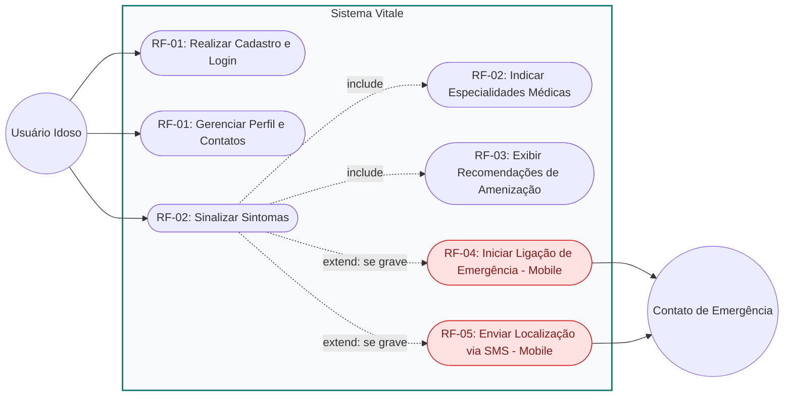
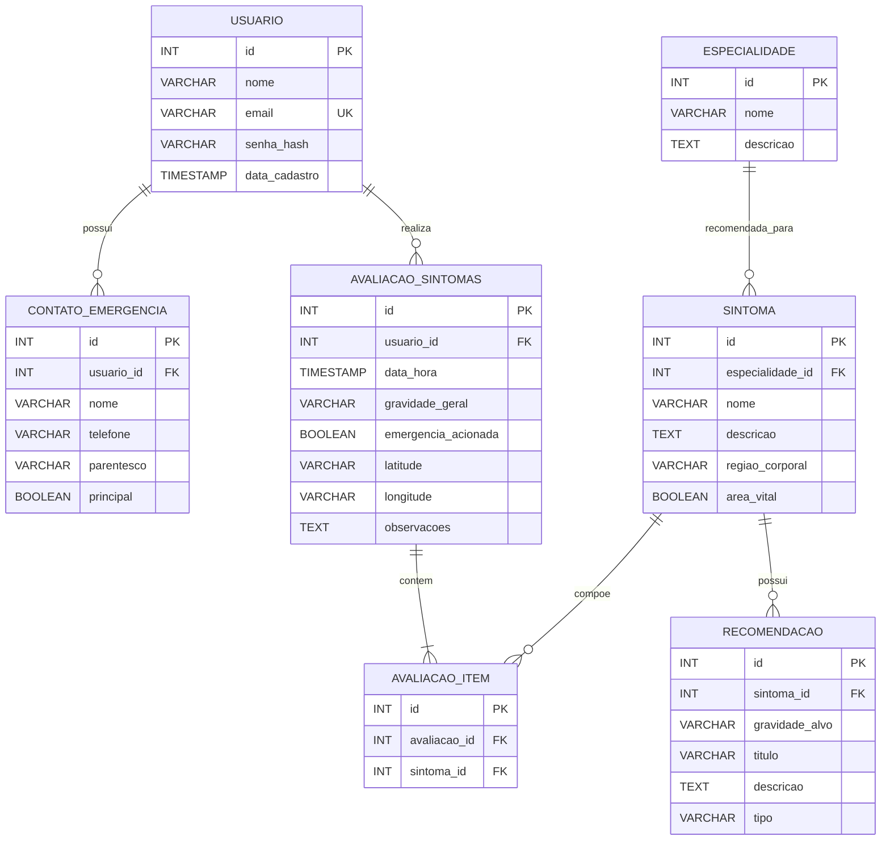
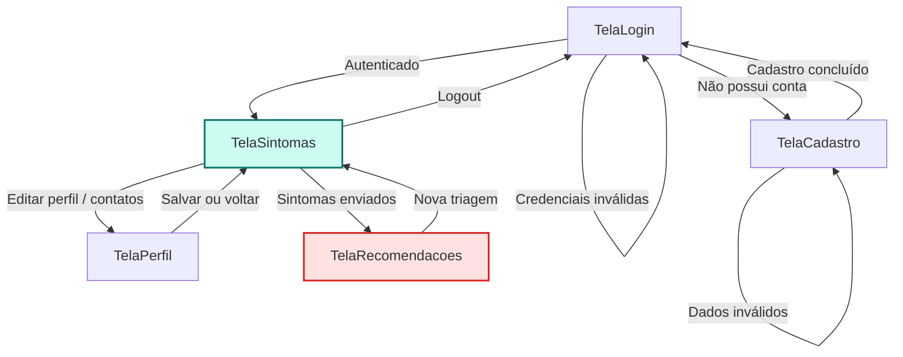

# Vitale — Documentação e Levantamento de Requisitos

**Plataforma Web e Mobile de Triagem de Sintomas Acessível para o Público Idoso**

**Autores:** Maria Eduarda Correa • Rian • Thayssa Maneo

---

[Pesquisas](#-0-pesquisas---principais-problemas-relacionados-ao-acesso-de-idosos-a-conteúdos-de-saúde) •
[Introdução](#-1-introdução) •
[Requisitos](#-2-requisitos-do-sistema) •
[Diagramas](#️-3-diagramas-do-sistema) •
[Relatório de Testes](#-4-relatório-de-testes)

 

## 0. Pesquisas - Principais problemas relacionados ao acesso de idosos a conteúdos de saúde

<table>
  <tr>
    <td width="50%" valign="top">
      <h3>0.1 Interfaces Inacessíveis e Falta de Design Inclusivo (UI/UX)</h3>
      <ul>
        <li><strong>Ausência de recursos essenciais de acessibilidade:</strong> Diversos portais e aplicativos falham em oferecer suporte a ferramentas básicas, como audiodescrição, ajustes de contraste e leitor de tela para pessoas com deficiências visuais ou auditivas.</li>
        <li><strong>Design inadequado às mudanças cognitivas e sensoriais:</strong> As plataformas raramente são projetadas levando em consideração as necessidades da população idosa, apresentando elementos visuais confusos, ícones de difícil visualização, botões pequenos e excesso de termos técnicos de tecnologia ("tecniquês") que prejudicam a navegação intuitiva.</li>
      </ul>
    </td>
    <td width="50%" valign="top">
      <h3>0.2 Barreiras de Linguagem e Complexidade do Conteúdo</h3>
      <ul>
        <li><strong>Linguagem médica técnica sem simplificação:</strong> Muitas plataformas institucionais de saúde utilizam terminologias científicas e médicas densas (como descrições técnicas de vacinas e mecanismos de ação) sem a devida adaptação para pessoas com menor escolaridade ou baixo letramento em saúde.</li>
        <li><strong>Falta de resumos executivos:</strong> Há escassez de materiais informativos formatados em linguagem simples e direta, o que limita a compreensão e a capacidade do idoso de agir de forma autônoma sobre a própria saúde.</li>
      </ul>
    </td>
  </tr>
  <tr>
    <td width="50%" valign="top">
      <h3>0.3 Insegurança, Medo de Errar e Ansiedade Gerontecnológica</h3>
      <ul>
        <li><strong>Receio de falhas e golpes digitais:</strong> É recorrente a hesitação dos idosos em interagir com interfaces digitais por medo de danificar o dispositivo, cometer erros de navegação ou ser vítima de fraudes e vazamento de dados pessoais.</li>
        <li><strong>Baixa percepção de autoeficácia:</strong> O preconceito etário (idadismo) e a falta de suporte inicial geram uma ansiedade gerontecnológica, fazendo com que muitos idosos se sintam incapazes de aprender a manusear novos recursos e acabem abandonando as aplicações.</li>
      </ul>
    </td>
    <td width="50%" valign="top">
      <h3>0.4 Dificuldade na Avaliação Crítica da Informação (Letramento Digital)</h3>
      <ul>
        <li><strong>Vulnerabilidade à desinformação:</strong> Devido ao baixo letramento digital em saúde, muitos idosos enfrentam grandes dificuldades para filtrar informações on-line, distinguir fontes de alta qualidade de conteúdos duvidosos e identificar fake news ou golpes.</li>
        <li><strong>Falta de confiança na tomada de decisões:</strong> Mesmo quando conseguem localizar informações digitais de saúde, o nível de confiança e segurança para avaliar a precisão do conteúdo e aplicar esses dados no cuidado diário permanece significativamente baixo.</li>
      </ul>
    </td>
  </tr>
  <tr>
    <td width="50%" valign="top">
      <h3>0.5 Foco Excessivo no Modelo Biomédico e Escassez de Guias Práticos</h3>
      <ul>
        <li><strong>Conteúdo centrado em doenças e tratamentos:</strong> Os portais costumam focar excessivamente em um modelo curativo e biomédico (como campanhas de vacinação e gestão de morbidades crônicas), em vez de promover uma visão integral de envelhecimento ativo.</li>
        <li><strong>Lacunas em áreas críticas de cuidado:</strong> Há pouca oferta de orientações práticas direcionadas ao suporte de familiares e cuidadores, além da sub-representação de temas como saúde mental e cuidados paliativos.</li>
      </ul>
    </td>
    <td width="50%" valign="top">
      <h3>0.6 Homogeneização do Usuário e Exclusão Social</h3>
      <ul>
        <li><strong>Desconsideração das diversidades regionais e de comorbidades:</strong> A maioria das soluções digitais adota uma abordagem genérica baseada em recomendações universais, ignorando adaptações para idosos com diferentes graus de limitação funcional, comorbidades ou pertencentes a comunidades rurais e indígenas.</li>
        <li><strong>Dependência exclusiva do meio digital:</strong> Ao focar a prestação de serviços e orientações quase exclusivamente em plataformas on-line ou aplicativos, acaba-se aprofundando a exclusão de idosos de menor renda e escolaridade que não possuem conectividade ou dispositivos adequados.</li>
      </ul>
    </td>
  </tr>
</table>

---

## 1. Introdução

### 1.1 Objetivo
Criar uma plataforma web e um aplicativo mobile para auxiliar o público idoso a sinalizar sintomas de forma acessível e intuitiva, oferecendo recomendações iniciais de amenização, indicação de especialidades médicas e acionamento de emergência em casos graves.

### 1.2 Funções do Sistema
De acordo com as necessidades dos stakeholders, as funções essenciais do sistema compreendem:

| # | Função | Descrição | Plataforma |
| :---: | :--- | :--- | :---: |
| **1** | **Gestão de conta e contatos** | Permitir o cadastro, autenticação e edição de dados do usuário e de seus contatos de emergência. | Web & Mobile |
| **2** | **Sinalização de sintomas e indicação de especialistas** | Permitir a sinalização de sintomas de forma simples e indicar especialidades médicas compatíveis com o relato. | Web & Mobile |
| **3** | **Recomendações para amenização de sintomas** | Após a sinalização dos sintomas, exibir técnicas de auxílio inicial e amenização de acordo com a gravidade identificada (ex.: exercícios de respiração). | Web & Mobile |
| **4** | **Contato com número de emergência** | Em caso de sintomas graves em áreas vitais, iniciar automaticamente uma ligação telefônica para o contato de emergência cadastrado *(função exclusiva do aplicativo mobile)*. | Mobile |
| **5** | **Localização do paciente** | Em caso de sintomas graves, coletar a localização em tempo real do paciente e enviá-la via SMS com as coordenadas ao contato de emergência *(função exclusiva do aplicativo mobile)*. | Mobile |

---

### 1.3 Páginas / Telas do Sistema

| Tela | Identificador | Descrição |
| :--- | :--- | :--- |
| **Tela de Login** | `TelaLogin` | Permite o acesso de usuários cadastrados por meio de autenticação segura. |
| **Tela de Cadastro** | `TelaCadastro` | Permite o registro de novos usuários com validação dos dados essenciais e cadastro do contato de emergência. |
| **Tela de Perfil** | `TelaPerfil` | Permite visualizar e editar os dados cadastrais do usuário e gerenciar seus contatos de emergência. |
| **Tela de Sinalização de Sintomas** | `TelaSintomas` | Interface principal onde o usuário seleciona e registra os sintomas apresentados. |
| **Tela de Recomendações e Emergência** | `TelaRecomendacoes` | Exibe as especialidades médicas indicadas, as recomendações de técnicas de amenização e aciona a ligação e o envio de localização via SMS ao contato de emergência quando houver gravidade. |

---

### 1.4 Tecnologias e Bibliotecas Utilizadas
O sistema é estruturado em duas aplicações independentes (*mobile* e *web*) que compartilham a mesma API REST e banco de dados:

 

* **Frontend — Aplicativo Mobile:**
  * **Flutter & Dart:** Framework e linguagem para desenvolvimento multiplataforma (Android e iOS).
  * **Pacotes Nativos de Telefonia e Geolocalização:** Utilizados para disparo de ligação telefônica, envio de SMS e captura de coordenadas GPS em situações de emergência.
* **Frontend — Plataforma Web:**
  * **React & Next.js:** Biblioteca e framework para construção da interface, gerenciamento de rotas e otimização de carregamento.
  * **TypeScript:** Superset JavaScript com tipagem estática para maior segurança e organização do código.
* **Backend — Servidor e Regras de Negócio:**
  * **Node.js & Express.js:** Ambiente de execução e framework para estruturação da API REST.
  * **TypeScript:** Linguagem utilizada no servidor para padronização e segurança de tipos.
* **Banco de Dados:**
  * **PostgreSQL:** Banco de dados relacional para armazenamento de usuários, contatos de emergência, sintomas, avaliações e recomendações.
  * **Prisma ORM:** Mapeamento objeto-relacional para comunicação segura e parametrizada com o banco de dados.
* **Integrações Complementares:**
  * **Serviços de Geolocalização (GPS / Google Maps API):** Utilizados para obtenção e formatação das coordenadas do paciente em casos de emergência.
* **Segurança:**
  * **HTTPS/TLS:** Criptografia de dados em trânsito entre cliente e servidor.
  * **JWT (JSON Web Token):** Autenticação e controle de sessão.
  * **bcrypt:** Hash seguro para armazenamento de senhas.
* **Ferramentas de Desenvolvimento:**
  * **Git e GitHub:** Versionamento de código.
  * **Visual Studio Code:** Ambiente de desenvolvimento.
  * **Stitch:** Prototipação das interfaces.

---

## 2. Requisitos do Sistema

### 2.1 Requisitos Funcionais (RF)

| ID | Requisito | Descrição | Plataforma |
| :--- | :--- | :--- | :---: |
| **`RF-01`** | **Gestão e Autenticação de Usuários** | O sistema deve permitir o cadastro, login, edição de perfil e gerenciamento de contatos de emergência, validando dados essenciais. | Web e Mobile |
| **`RF-02`** | **Sinalização e Triagem de Sintomas** | O sistema deve permitir ao usuário selecionar sintomas de forma intuitiva, avaliar sua gravidade e indicar especialidades médicas compatíveis com o relato. | Web e Mobile |
| **`RF-03`** | **Recomendações de Técnicas** | O sistema deve apresentar recomendações de técnicas para amenização dos sintomas de acordo com a gravidade identificada. | Web e Mobile |
| **`RF-04`** | **Ligação para Contato de Emergência** | Em caso de sintomas graves em áreas vitais, o sistema deve iniciar uma ligação telefônica para o contato de emergência principal. | Mobile |
| **`RF-05`** | **Localizar Paciente** | Em caso de sintomas graves, o sistema deve coletar a localização em tempo real do paciente e enviá-la por SMS ao contato de emergência. | Mobile |

### 2.2 Requisitos Não Funcionais (RNF)

| ID | Categoria | Descrição |
| :--- | :--- | :--- |
| **`RNF-01`** | **Usabilidade Senior (UX/UI)** | As interfaces web e mobile devem seguir diretrizes de acessibilidade (WCAG 2.1 AA), utilizando fontes ampliadas (mínimo 16px), alto contraste de cores e áreas de toque mínimas de 48x48dp. |
| **`RNF-02`** | **Desempenho e Disponibilidade** | A aplicação deve carregar as telas principais em menos de 2 segundos sob conexões 3G/4G e manter disponibilidade mínima de 99,5%. |
| **`RNF-03`** | **Segurança e Privacidade (LGPD)** | O sistema deve proteger dados sensíveis de saúde e credenciais (HTTPS/TLS em trânsito, hash bcrypt para senhas e criptografia em repouso), garantindo conformidade com a LGPD. |
| **`RNF-04`** | **Compatibilidade Multiplataforma** | O aplicativo mobile deve ser compatível com Android (8.0+) e iOS (14+). A versão web deve ser responsiva nos principais navegadores modernos. |
| **`RNF-05`** | **Escalabilidade e Manutenibilidade** | A arquitetura backend (API REST) deve suportar acessos concorrentes sem degradação de desempenho e manter separação clara entre regras de negócio e persistência. |

---

## 3. Diagramas do Sistema

### 3.1 Diagrama de Casos de Uso
*(Representação dos atores e funcionalidades mapeadas nos Requisitos Funcionais)*

### 3.2 MER - Modelo Entidade Relacionamento

### 3.3 Fluxo de navegação

---

## 4. Relatório de testes

| Campo | Informação |
| :--- | :--- |
| **Nome do Site / Sistema:** | Vitale |
| **URL / Ambiente Testado:** | `[Preencher]` |
| **Versão / Build:** | `1.0` |
| **Data da Execução:** | `[Preencher]` |
| **Responsável pelos Testes:** | `[Preencher]` |
| **Navegadores Testados:** | `[Preencher]` |
| **Dispositivos / Resoluções:** | `[Preencher]` |

### 4.1 Resumo Executivo
* **Parecer Geral:** `[ ] Aprovado` | `[ ] Aprovado com Ressalvas` | `[ ] Reprovado`
* **Objetivo:** Validar as funcionalidades principais, responsividade, integridade dos dados e requisitos de segurança antes da entrega ou publicação em produção.

### 4.2 Escopo dos Testes
* **Módulos Incluídos:**
  * Autenticação (Login, Logout e Expiração de Sessão)
  * Painel Inicial (Dashboard e Tela de Sintomas)
  * Gerenciamento de Cadastros (Criar, Listar, Buscar, Editar e Excluir)
  * Responsividade e Compatibilidade entre Navegadores
* **Fora do Escopo:** `[Preencher]`

---

### 4.3 Matriz de Execução de Casos de Teste

<b>Testes Funcionais (Clique para expandir/recolher)</b>

 

| ID | Módulo / Página | Cenário de Teste | Resultado Esperado | Resultado Obtido | Status |
| :--- | :--- | :--- | :--- | :--- | :---: |
| **`CT-01`** | Login | Acessar com credenciais válidas | Redirecionar para o painel inicial e exibir o nome do usuário | `[Descrever]` | Pass / Fail |
| **`CT-02`** | Login | Acessar com e-mail ou senha inválidos | Bloquear acesso e exibir mensagem de erro clara | `[Descrever]` | Pass / Fail |
| **`CT-03`** | Cadastro (Create) | Preencher formulário válido e salvar | Registrar no banco de dados e exibir na listagem | `[Descrever]` | Pass / Fail |
| **`CT-04`** | Listagem / Busca | Pesquisar registro por termo existente e inexistente | Filtrar resultados corretamente ou informar lista vazia | `[Descrever]` | Pass / Fail |
| **`CT-05`** | Edição (Update) | Alterar dados de um registro existente | Atualizar informações no banco e refletir na tela | `[Descrever]` | Pass / Fail |
| **`CT-06`** | Exclusão (Delete) | Remover ou cancelar um registro | Solicitar confirmação e atualizar a listagem | `[Descrever]` | Pass / Fail |

<b>Interface, Usabilidade e Responsividade (Clique para expandir/recolher)</b>

 

| ID | Critério Avaliado | Descrição da Verificação | Observações | Status |
| :--- | :--- | :--- | :--- | :---: |
| **`UI-01`** | Layout Desktop | Alinhamento de cards, tabelas, fontes, cores e contrastes | `[Descrever]` | Pass / Fail |
| **`UI-02`** | Layout Mobile | Adaptação de menus, formulários e tabelas sem quebra horizontal | `[Descrever]` | Pass / Fail |
| **`UI-03`** | Navegação e Links | Funcionamento de menus, botões "Voltar/Cancelar" e ausência de erro 404 | `[Descrever]` | Pass / Fail |
| **`UI-04`** | Feedback ao Usuário | Exibição clara de alertas de sucesso, erro e campos obrigatórios | `[Descrever]` | Pass / Fail |

<b>Segurança e Validação de Dados (Clique para expandir/recolher)</b>

 

| ID | Verificação | Procedimento de Teste | Resultado Esperado | Status |
| :--- | :--- | :--- | :--- | :---: |
| **`SEC-01`** | Controle de Acesso | Tentar acessar rotas internas via URL sem estar autenticado | Bloquear acesso e redirecionar para `/login` | Pass / Fail |
| **`SEC-02`** | Validação de Campos | Enviar formulários vazios ou com formatos inválidos (e-mail, data, CPF) | Impedir envio e validar no front-end e back-end | Pass / Fail |
| **`SEC-03`** | Proteção XSS | Inserir tags HTML/JS (``) em campos de texto | Texto exibido escapado como string comum, sem execução | Pass / Fail |
| **`SEC-04`** | SQL Injection | Inserir caracteres especiais (`' OR '1'='1`) em campos de busca e login | Consulta parametrizada (PDO) bloqueia injeção sem erro fatal | Pass / Fail |
| **`SEC-05`** | Proteção CSRF | Enviar requisição POST sem token CSRF ou com token adulterado | Requisição rejeitada pelo servidor | Pass / Fail |
| **`SEC-06`** | Dados Sensíveis (LGPD) | Verificar armazenamento de senhas e documentos sensíveis no banco | Senhas com hash seguro e dados sensíveis criptografados | Pass / Fail |

---

### 4.4 Registro de Bugs e Não Conformidades

| ID Bug | Caso Relacionado | Título / Descrição do Problema | Passos para Reproduzir | Severidade | Evidência | Status |
| :--- | :--- | :--- | :--- | :---: | :--- | :---: |
| **`BUG-01`** | `[Ex.: UI-02]` | `[Ex.: Tabela ultrapassa a largura da tela no celular]` | `[1. Abrir /agendamentos; 2. Reduzir tela para 375px]` | Média | `[Link/Print]` | Aberto |
| **`BUG-02`** | `[Ex.: CT-04]` | `[Ex.: Erro ao salvar data em branco]` | `[1. Abrir formulário; 2. Deixar campo vazio; 3. Salvar]` | Alta | `[Link/Print]` | Corrigido |

> **Legenda de Severidade:**
> * **Crítica:** Impede o uso do sistema, causa perda de dados ou falha grave de segurança.
> * **Alta:** Funcionalidade principal comprometida, sem alternativa simples de contorno.
> * **Média:** Falha parcial que afeta a experiência, mas permite continuar usando o sistema.
> * **Baixa:** Ajuste visual, ortográfico ou melhoria estética pontual.

### 4.5 Recomendações e Aprovação

**Pontos de Melhoria / Observações Técnicas:** `[Preencher]`

---

  Documentação elaborada conforme o padrão <b>ISO/IEC/IEEE 29148:2018</b> • Projeto <b>Vitale</b> (2026)

